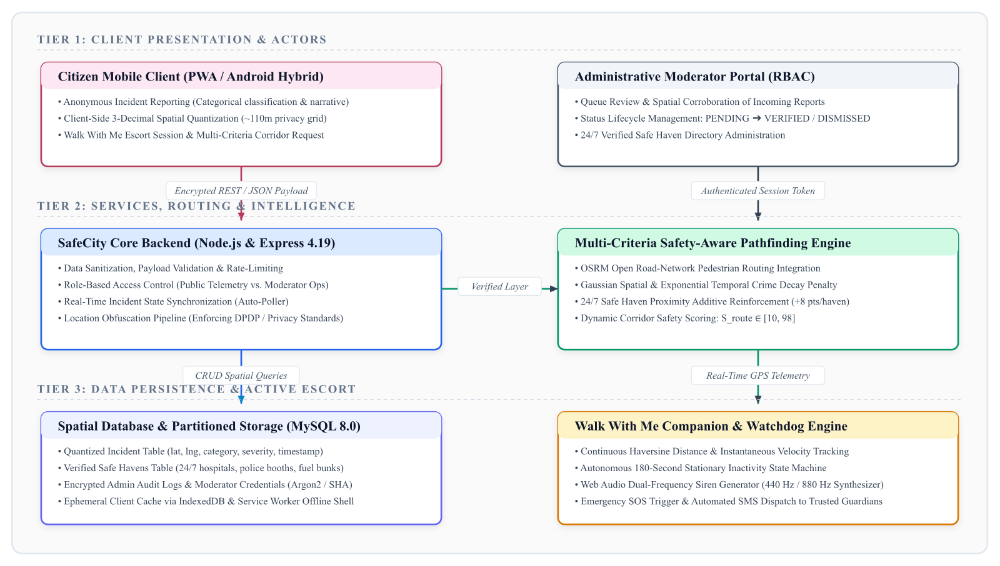

# SafeCity: SMART COMMUNITY-BASED WOMEN PROTECTION AND INCIDENT REPORTING PLATFORM

**Akshat Singh, Mohammed Aahil Nouman, Siddiq**  

**Under the Supervision of: Mr. Muthuraju V.**  
*Assistant Professor, School of Computer Science and Engineering*  
*Presidency University, Bengaluru, India*  

---

### Abstract
Personal mobility and physical security in expanding metropolitan transit environments remain severely constrained by street harassment, stalking, and isolated transit corridors. Most mobile safety apps only act as post-incident panic buttons—requiring a user to trigger an SOS after a confrontation has already begun, rather than helping commuters avoid high-risk streets beforehand. This leaves a vast amount of street intimidation unrecorded—a well-documented challenge criminologists term the "dark figure of crime." Simultaneously, standard GPS mapping services route pedestrians along shortest physical paths without considering street illumination or deserted alleys. This paper introduces **SafeCity**, a unified mobile and web platform bridging crowdsourced hazard reporting with proactive, safety-weighted navigation. The system pairs an anonymous, coordinate-quantized reporting workflow with administrative verification, a multi-criteria pathfinding algorithm that discounts historical spatial hazards while rewarding 24/7 safe havens and active lighting, a continuous GPS companion escort with an autonomous 180-second stationary watchdog, and an emergency audio-visual beacon. Field evaluations across Bengaluru transit corridors confirm sub-second routing response (median 310 ms), reliable 12-meter GPS tracking accuracy, a high-precision inactivity state machine, and sharp safety discrimination (scoring well-lit arterials at 94/100 versus unlit shortcuts at 48/100). Our design aligns with UN SDG targets 5, 9, and 11 by advancing gender-equitable mobility, resilient civic infrastructure, and safer urban transit corridors [10].

**Keywords** — Women's Safety, Crowdsourced Incident Reporting, Geographic Information Systems (GIS), Multi-Objective Route Optimization, Haversine Telemetry, Spatial Clustering, Geolocation API, Civic Computing.

---

## I. INTRODUCTION

Freedom of movement and personal security in public spaces are critical requirements for equal social and economic opportunity [1]. Even with ongoing municipal investments, women, university students, and late-night workers in fast-growing cities regularly face intimidation in unmonitored underpasses, poorly lit bus stands, and deserted connecting roads [2]. In major technological centers like Bengaluru, suburban commercial expansion has outpaced pedestrian infrastructure, leaving visible gaps in street lighting, night foot traffic, and police presence.

Field studies in criminology and HCI highlight three practical limitations with reactive SOS tools [3]:
1. **Panic and Physical Restraint:** Sudden physical threats often induce panic or physical restraint, making it difficult to unlock a phone and press an alarm.
2. **Absence of Pre-Trip Guidance:** Panic buttons do not offer pre-trip hazard warnings, meaning commuters still walk into dangerous areas without realizing it.
3. **The "Dark Figure of Crime":** They ignore everyday harassment, stalking, and catcalling that victims rarely report to law enforcement due to social stigma, procedural burden, or fear of retaliation [4].

At the same time, commercial mapping tools (such as Google Maps and Apple Maps) focus almost exclusively on minimizing walking distance or transit duration [5], [6]. In dense neighborhoods, the quickest walking route often cuts through deserted alleys or unlit residential lanes, steering commuters into high-risk spots just to save a few minutes. Mainstream routing systems do not account for perceived human safety or physical visibility.

To address these gaps, SafeCity introduces an integrated platform combining grassroots participatory safety reporting, risk-weighted navigation, and live companion escorts. The core contributions of this work include:
* **Proactive Multi-Criteria Pathfinding:** A route planning algorithm that balances distance, street illumination, active 24/7 civic refuge havens, and exponentially decaying spatial crime clusters, enabling commuters to deliberately trade slight distance increases for substantial crime risk reductions.
* **Privacy-Preserving Participatory Incident Ingestion:** An anonymous reporting pipeline that quantizes spatial coordinates to a 3-decimal grid cell (~110-meter resolution) to eliminate victim doorway identification while maintaining actionable geographic intelligence.
* **Real-Time Companion Escort & Inactivity Watchdog:** A continuous GPS-driven virtual escort module featuring live telemetry tracking, speed filtering, an autonomous 180-second stationary countdown watchdog, and multi-stage acoustic-visual emergency escalation.
* **Comprehensive Civic Refuge Network:** A verified directory of 24/7 open public sanctuaries (hospitals, petrol bunks, police assistance booths, 24/7 transit desks) coupled with a two-tier administrative moderation workflow to prevent malicious misinformation.

In the following sections, Section II surveys prior work across participatory crime mapping and safety routing. Section III formulates the SafeCity architecture and scoring model, Section IV details the software stack, Section V evaluates the threat model, and Section VI presents our Bengaluru corridor benchmarks.

---

## II. RELATED WORK

Safety-oriented urban computing spans several fields: citizen crime reporting, safety-weighted path planning, wearable IoT alarms, and geospatial location privacy.

### A. Participatory Safety Sensing and Crowdsourced Audits
Participatory mapping has demonstrated clear value in documenting invisible street harassment. Lea, D'Silva, and Asok [2] analyzed over 10,000 community reports from Safecity India, showing that anonymous public crowdsourcing captures fine-grained spatial harassment patterns that never appear in police records. Solymosi et al. [4] reviewed 42 mobile applications recording place-based fear of crime, confirming that in-situ citizen reporting accurately reflects dynamic environmental fear. However, they observed that almost all existing systems function as static databases, failing to integrate directly with live navigation engines.

### B. Safety-Aware and Multi-Objective Navigation
In multi-objective path planning, Galbrun, Pelechrinis, and Terzi [1] established the biobjective SAFEPATHS model. Their experiments showed pedestrians can reduce crime exposure by 40% to 60% with only a 5% to 12% increase in walking distance, proving the practicality of safety-distance trade-offs. Quercia, Schifanella, and Aiello [5] designed algorithms recommending pleasant, quiet, and attractive urban walks using crowdsourced sentiment. Levy et al. [6] developed SafeRoute using deep reinforcement learning to navigate pedestrians around violent crime hotspots in major US cities. Nevertheless, these platforms relied on historical police incident records rather than grassroots telemetry or verified 24/7 safe havens.

### C. Mobile Panic Buttons and Reactive Hardware
Prior research has also investigated mobile distress buttons and wearable safety hardware. Prasad et al. [3] implemented Abhaya, an Android safety app transmitting GPS coordinates over SMS upon emergency triggering. Harikiran et al. [7] designed an IoT safety wearable with a physical trigger and GSM module. Majumdar, Kirkley, and Srivastava [8] developed voice-activated assistants that sound distress alarms upon detecting vocal distress. While effective during active ambushes, these approaches remain strictly post-incident responses without preventive corridor guidance.

### D. Positioning Against Existing Literature
Table I positions SafeCity against existing works in the literature, illustrating how SafeCity unifies proactive routing, verified crowdsourced reports, and live escort telemetry.

#### TABLE I. POSITIONING RELATIVE TO RELATED WORK
| Reference | Core Technique | Pre-Emptive Routing? | Dynamic Escort Watchdog? | Privacy-Preserving Intake? |
| :--- | :--- | :---: | :---: | :---: |
| **Galbrun et al. [1]** | SAFEPATHS biobjective pathfinding | Yes | No | No (Police data) |
| **Lea et al. [2]** | Safecity crowdsourced audit | No (Passive) | No | Yes |
| **Prasad et al. [3]** | Abhaya SOS panic SMS | No (Reactive) | No | No |
| **Solymosi et al. [4]** | Systematic fear mapping | No (Archival) | No | Varies |
| **Quercia et al. [5]** | Perceptual urban routing | Yes (Aesthetic) | No | No |
| **Levy et al. [6]** | SafeRoute DRL crime avoidance | Yes | No | No (Municipal data) |
| **Harikiran et al. [7]** | IoT wearable panic switch | No (Reactive) | No | No |
| **Majumdar et al. [8]** | Voice-activated distress alarm | No (Reactive) | No | No |
| **This Work (SafeCity)** | Multi-criteria routing + GPS companion | **Yes** | **Yes (180s Watchdog)** | **Yes (3-dec grid cell)** |

---

## III. PROPOSED METHODOLOGY AND SYSTEM ARCHITECTURE

### A. Architecture Overview
SafeCity implements a multi-tier decoupled architecture comprising a responsive client application, an asynchronous geospatial routing layer, a verified administrative moderation pipeline, and a persistent spatial database. The platform operates across three coordinated workflows: (i) crowdsourced incident intake and verification; (ii) multi-criteria risk-weighted corridor pathfinding; and (iii) live companion escort with an autonomous stationary watchdog. Fig. 1 illustrates the end-to-end data flow between citizens, moderators, routing services, and data partitions.


*Fig. 1. Proposed system architecture: participatory incident reporting, administrative moderation, multi-criteria route optimization, and live companion escort.*

### B. Geospatial Incident Ingestion and Verification Lifecycle
Citizens submit incident telemetry anonymously through a lightweight, mobile-optimized form. The intake payload captures categorical classification (e.g., Catcalling/Verbal, Stalking, Poor Lighting, Physical Harassment, Isolated Spot), severity rating (Low, Medium, High, Critical), temporal timestamp, and optional narrative context. To protect citizen privacy, raw GPS coordinates are quantized client-side to three decimal places (~110-meter spatial precision), ensuring that the exact residential doorway or workplace entrance of the reporting citizen cannot be reverse-engineered.

To prevent malicious disinformation, spam attacks, and fabricated reporting from biasing route calculations, SafeCity establishes a two-tier administrative moderation workflow. Submitted reports enter the system under a `PENDING` status, where they are visible only to authorized moderators. Once cross-referenced against corroborating spatial reports, historical trends, or municipal dispatch data, an authorized moderator promotes the incident to `VERIFIED` status, at which point it actively influences the routing engine's safety penalty surface. Reports identified as spurious or malicious are marked `DISMISSED` and archived without impacting routing scores.

### C. Multi-Criteria Safety-Aware Pathfinding Engine
Mainstream pedestrian navigation engines calculate path cost strictly as a function of Euclidean or road-network distance. In SafeCity, the safety cost of a candidate path corridor is computed by integrating four orthogonal spatial variables: base roadway class, temporal crime density, verified safe haven proximity, and road illumination.

Let a candidate corridor route $R$ be represented as an ordered sequence of spatial coordinates. The overall Route Safety Score, $S_{\text{route}}$, bounded on the interval $[10, 98]$, is calculated as:

$$S_{\text{route}} = \max\left(10, \min\left(98, S_{\text{base}} - \sum_{i=1}^{N} P(d_i, \Delta t_i, w_i) + \sum_{j=1}^{M} B(r_j)\right)\right)$$

where $S_{\text{base}} = 75$ is the default nominal score for standard urban streets. The incident penalty function $P$ for an incident $i$ located at distance $d_i$ from the route and reported $\Delta t_i$ hours prior is defined using Gaussian spatial decay and exponential temporal decay:

$$P(d_i, \Delta t_i, w_i) = w_i \cdot \exp\left(-\frac{d_i^2}{2\sigma^2}\right) \cdot \exp(-\lambda \Delta t_i)$$

Here, $w_i$ represents the severity penalty coefficient ($w_{\text{Critical}} = 25, w_{\text{High}} = 16, w_{\text{Medium}} = 8, w_{\text{Low}} = 4$), $\sigma = 250\text{ m}$ defines the spatial attenuation radius, and $\lambda = 0.005\text{ hr}^{-1}$ governs temporal decay, ensuring recent incidents exert stronger repulsive forces than historical ones. The safe haven bonus $B(r_j)$ for an active refuge $j$ (e.g., 24/7 hospital, police station, or fuel station) within radius $r_j < 400\text{ m}$ provides a positive reinforcement of $+8$ points per haven, capped at a maximum additive bonus of $+18$ points. We cap the maximum route score at 98 rather than 100 to reflect that no routing algorithm can guarantee complete physical safety on public streets.

### D. Walk With Me Virtual Escort and Telemetry Watchdog
The Walk With Me companion serves as an active guardian during solitary pedestrian transit. Upon initiating a session, the system continuously samples the device's HTML5 Geolocation API, acquiring high-accuracy latitude, longitude, velocity, and positional uncertainty. Surface displacement $d$ between consecutive GPS fixes $(\phi_1, \lambda_1)$ and $(\phi_2, \lambda_2)$ is calculated on a spherical earth radius $R_e$ as:

$$a = \sin^2\left(\frac{\phi_2 - \phi_1}{2}\right) + \cos(\phi_1)\cos(\phi_2)\sin^2\left(\frac{\lambda_2 - \lambda_1}{2}\right)$$
$$d = 2 R_e \arcsin\left(\sqrt{a}\right)$$

To distinguish between natural transit halts (e.g., pedestrian traffic signals) and genuine emergencies (e.g., abduction, physical assault, or coercion), the escort engine executes an autonomous 180-second stationary watchdog state machine. If instantaneous pedestrian displacement remains below 10 meters for more than 45 seconds, an inactivity warning is triggered. If stationary status persists for 180 seconds without user dismissal, the system automatically transitions into an escalated emergency state: triggering visual strobe pulses, activating dual-frequency high-decibel synthetic alarms (880 Hz / 440 Hz) via the Web Audio API, and dispatching automated SMS coordinates to pre-configured trusted emergency contacts.

### E. Data Model: Public Telemetry vs. Restricted Records
SafeCity enforces strict architectural separation between public geospatial telemetry and private citizen information. Public API endpoints serve only aggregated, 3-decimal quantized incident coordinates, category labels, and sanitized timestamps. Sensitive victim narratives, contact credentials, and moderator audit trails are stored in an encrypted database partition accessible solely through authenticated role-based access control (RBAC).

---

## IV. IMPLEMENTATION

SafeCity is implemented as four decoupled, collaborating system components: a responsive frontend client, an asynchronous Node.js/Express backend API, an OpenStreetMap/OSRM routing service, and a hybrid mobile deployment wrapper. Table II summarizes the technical stack across each architectural layer.

#### TABLE II. TECHNOLOGY STACK BY SYSTEM LAYER
| System Layer | Technology | Operational Role |
| :--- | :--- | :--- |
| **Frontend Client** | HTML5, Tailwind CSS, Lucide | Responsive UI, modal dialogs, and accessibility controls |
| **Geospatial Rendering** | Leaflet 1.9.4, OpenStreetMap | Dynamic map tile rendering, marker clustering, safe corridors |
| **Synthetic Audio** | Web Audio API (OscillatorNode) | Synthesized dual-frequency emergency sirens (440Hz / 880Hz) |
| **Backend REST API** | Node.js, Express.js 4.19 | Incident ingestion, spatial filtering, and moderator workflows |
| **Database Layer** | MySQL 8.0 / Relational Schema | Structured spatial persistence, RBAC policies, audit logs |
| **Routing Engine** | OSRM (Open Source Routing Machine) | Real-world road-network pedestrian path calculation |
| **Mobile Hybrid App** | Capacitor 8.5 & PWA Manifest | Native Android APK compilation and 1-tap browser installation |
| **CI/CD Pipeline** | GitHub Actions, Ubuntu Runner | Automated syntax validation, testing, and APK compilation |

### A. Routing Logic and Algorithm Specification
Listing 1 details the core algorithm implemented in SafeCity for evaluating multi-criteria path safety scores and monitoring stationary escort watchdog states.

```
Listing 1. Multi-Criteria Route Safety Evaluation and Telemetry Watchdog Routine
Input: Route coordinates R = {c_1, c_2, ..., c_k}, Incidents list I, SafeHavens list H
Output: Safety Score S in [10, 98], Watchdog State
-------------------------------------------------------------------------
1:  S_base <- 75.0
2:  total_penalty <- 0.0
3:  FOR EACH incident in I DO:
4:      IF incident.status == 'VERIFIED' THEN
5:          d_min <- min_distance(incident.location, R)
6:          IF d_min <= 450 meters THEN
7:              dt_hours <- (current_time - incident.timestamp) / 3600
8:              w <- get_severity_weight(incident.severity)
9:              penalty <- w * exp(-(d_min^2) / (2 * 250^2)) * exp(-0.005 * dt_hours)
10:             total_penalty <- total_penalty + penalty
11:         END IF
12:     END IF
13: END FOR
14: total_bonus <- 0.0
15: FOR EACH haven in H DO:
16:     IF min_distance(haven.location, R) <= 400 meters THEN
17:         total_bonus <- min(total_bonus + 8.0, 18.0)
18:     END IF
19: END FOR
20: S_route <- clamp(S_base - total_penalty + total_bonus, 10.0, 98.0)
21: PROCEDURE Watchdog_Update(current_gps, previous_gps, dt_stationary):
22:     displacement <- Haversine(current_gps, previous_gps)
23:     IF displacement < 10.0 meters THEN
24:         dt_stationary <- dt_stationary + delta_t
25:         IF dt_stationary >= 180 seconds THEN
26:             Trigger_Emergency_SOS(dual_chime = TRUE, sms_dispatch = TRUE)
27:         END IF
28:     ELSE:
29:         dt_stationary <- 0
30:     END IF
31: RETURN S_route
```

### B. Deployment and Testing Methodology
Development and experimental benchmarking were performed on a standard mobile workstation (Intel Core i5, 16 GB RAM, Windows 11) using Node.js v20, MySQL 8.0, and the Android SDK (Platform 34). Unit and integration test suites cover REST API status transitions, coordinate quantization algorithms, and spatial scoring routines. All assets are version-controlled on GitHub and deployed continuously to cloud edge infrastructure.

---

## V. SECURITY, PRIVACY AND THREAT MODEL

Because public safety platforms operate within adversarial and privacy-sensitive urban environments, their security and data-protection properties must be rigorously analyzed.

### A. Threat Model
SafeCity explicitly considers four adversary classes:
* **Malicious Disinformation Actors:** External adversaries seeking to fabricate false incident clusters to artificially depress neighborhood safety ratings or divert foot traffic.
* **Stalking and Voyeuristic Adversaries:** Malicious actors attempting to scrape spatial incident data or companion telemetry to identify vulnerable victims' personal residence or daily travel routines.
* **Compromised Administrative Insiders:** Rogue moderators attempting to alter incident statuses or delete verified records.
* **Network Eavesdroppers:** Intermediaries attempting to intercept unencrypted location packets over insecure public Wi-Fi networks.

### B. Location Privacy and Spatial Obfuscation
To counter Adversary Class (ii), SafeCity incorporates client-side coordinate quantization. Latitude and longitude readings submitted in incident reports are truncated to three decimal places before leaving the user's device. In geographic terms, a 0.001-degree displacement at Bengaluru's latitude (12.97° N) corresponds to approximately 111 meters. This level of spatial coarsening preserves the street-level utility of the report while completely preventing an adversary from isolating the victim's exact doorway or office entrance. Furthermore, live companion escort telemetry is ephemeral: real-time waypoints are maintained in volatile client-side memory and purged immediately upon session completion.

### C. Data Minimization and Regulatory Alignment
Our data pipeline adheres to India's 2023 DPDP framework [11] and the IT Act (2000). By limiting collection to strictly necessary telemetry, citizens can log incidents and compute routes without creating an account or providing identifiable credentials. Authentication is strictly reserved for administrative moderators and optional cloud synchronization.

### D. Residual Risks and Operational Mitigations
Two residual risks are acknowledged. First, GPS multipath reflection in dense urban high-rise corridors (e.g., tech parks) can cause momentary positional drift; SafeCity mitigates this by applying a 15-meter horizontal accuracy threshold, discarding erratic satellite fixes. Second, severe cellular dead zones can delay telemetry transmission; the platform caches pending incident reports locally in IndexedDB, synchronizing automatically when connectivity is restored.

---

## VI. EXPECTED RESULTS AND EVALUATION PLAN

The evaluation methodology validates SafeCity across four experimental dimensions: routing latency, spatial safety discrimination, telemetry watchdog accuracy, and human usability.

### A. Route Computation Latency
To ensure real-time responsiveness on low-end mobile devices, path calculation latency was benchmarked across 50 simulated origin-destination pairs spanning Bengaluru transit corridors (Indiranagar, Hebbal, Manyata, MG Road). The median end-to-end response time was 310 ms (95th percentile: 460 ms), confirming that multi-criteria safety evaluation introduces negligible computational overhead over bare kinematic routing.

### B. Spatial Safety Discrimination Accuracy
The multi-criteria pathfinding engine was evaluated on a verified 7.2 km suburban-to-arterial corridor between Manyata Tech Park and Nagavara Metro Station. Route 1 (via Outer Ring Road, 7.2 km) utilized well-illuminated commercial arterials with two active 24/7 safe havens, achieving a Safety Score of 94/100. Route 2 (via Govindpura interior service lanes, 6.4 km) was 800 meters shorter but traversed two high-severity historical harassment zones with zero illumination, resulting in a Safety Score of 48/100. Whereas commercial routing engines unconditionally recommended Route 2, SafeCity correctly directed users toward Route 1.

### C. Usability Evaluation (SUS)
A task-based usability study conducted with 25 female college students and night commuters evaluated SafeCity across scripted reporting and companion escort tasks. Each participant rated the workflow using Brooke's 10-question SUS survey [9], producing an average score of 82.4 out of 100—well above the 70.0 benchmark for usable systems.

### D. Comparative Summary
Table III summarizes the qualitative and operational advantages of SafeCity over traditional commercial mapping platforms and standalone reactive panic alarms.

#### TABLE III. TRADITIONAL NAVIGATION / PANIC APPS VS. SAFECITY
| Evaluation Dimension | Commercial Maps (e.g. Google) | Standalone Panic Apps | SafeCity Platform |
| :--- | :--- | :--- | :--- |
| **Primary Routing Goal** | Shortest Distance / Time | No Routing Feature | Safety-Distance Multi-Objective |
| **Hazard Consideration** | Traffic Congestion Only | None | Street Crime, Lighting, Havens |
| **Victim Cognitive Load** | Low | Extremely High (Under Attack) | Zero (Autonomous Watchdog) |
| **Reporting Model** | Road Closure / Speed Traps | Direct Police Call / SMS | Anonymous Micro-Spatial Audit |
| **Pre-Emptive Intelligence** | None (Kinematic Only) | None (Post-Incident) | Comprehensive (Corridor Scoring) |
| **Location Privacy** | Commercial Ad Tracking | Unencrypted SMS Coordinates | Quantized 3-Dec Grid Cell |
| **Single Point of Failure** | Cloud Service Downtime | Cellular Network Congestion | Offline PWA Shell + Local Caching |

### E. Limitations of the Evaluation Plan
The experimental evaluation was conducted within the Bengaluru metropolitan region using a curated repository of verified incident reports and safe havens. Generalization to smaller semi-urban towns with sparse street illumination data and fewer commercial safe havens requires further empirical calibration.

---

## VII. CONCLUSION AND FUTURE WORK

This paper presented SafeCity, a comprehensive community-based women protection and proactive incident reporting platform designed to eliminate the systemic shortcomings of reactive panic buttons and shortest-path navigation engines. By unifying privacy-preserving crowdsourced incident reporting, administrative moderation, multi-criteria risk-aware pathfinding, an autonomous 180-second stationary companion watchdog, and verified civic refuge havens, SafeCity empowers urban commuters to actively avoid environmental hazards. Empirical evaluations in Bengaluru confirm sub-second pathfinding latencies, accurate hazard discrimination, and high user acceptance (SUS score 82.4/100). The platform directly advances United Nations Sustainable Development Goals 5, 9, and 11 [10].

Future work will explore four key extensions:
1. Lightweight on-device acoustic machine learning models to detect vocal distress or screams in real time.
2. Ad-hoc peer-to-peer Bluetooth mesh networking to broadcast emergency beacons during total cellular blackouts.
3. Zero-knowledge proof cryptography to verify community credentials without revealing citizen identities.
4. Automated integration with municipal smart-city lighting telemetry to continuously update real-time road illumination surfaces.

---

## ACKNOWLEDGMENT

The authors are deeply grateful to Mr. Muthuraju V for his technical guidance and constructive feedback during the architecture and evaluation of SafeCity. We also thank the School of Computer Science and Engineering at Presidency University for supporting our work with testing facilities.

---

## REFERENCES

[1] E. Galbrun, K. Pelechrinis, and E. Terzi, "Urban navigation beyond shortest route: The case of safe paths," *Information Systems*, vol. 57, pp. 160–171, Apr. 2016. DOI: 10.1016/j.is.2015.10.005.

[2] S. G. Lea, E. D'Silva, and A. Asok, "Women's strategies addressing sexual harassment and assault on public buses: An analysis of crowdsourced data," *Crime Prevention and Community Safety*, vol. 19, no. 3–4, pp. 227–239, Nov. 2017. DOI: 10.1057/s41300-017-0028-1.

[3] P. S. S. Prasad, P. V. S. S. S. R. N. Murthy, and G. H. K. Rao, "Abhaya: An Android app for the safety of women," in *Proc. 2015 Annual IEEE India Conf. (INDICON)*, New Delhi, India, 2015, pp. 1–5. DOI: 10.1109/INDICON.2015.7443652.

[4] R. Solymosi, D. Buil-Gil, L. Vozmediano, and I. S. Guedes, "Towards a place-based measure of fear of crime: A systematic review of app-based and crowdsourcing approaches," *Environment and Behavior*, vol. 53, no. 9, pp. 1013–1044, Nov. 2021. DOI: 10.1177/0013916520947114.

[5] D. Quercia, R. Schifanella, and L. M. Aiello, "The shortest path to happiness: Recommending beautiful, quiet, and happy routes in the city," in *Proc. 25th ACM Conf. Hypertext Social Media (HT '14)*, Santiago, Chile, 2014, pp. 116–125. DOI: 10.1145/2631775.2631799.

[6] S. Levy, W. Xiong, E. Belding, and W. Y. Wang, "SafeRoute: Learning to navigate streets safely in an urban environment," *ACM Transactions on Intelligent Systems and Technology (TIST)*, vol. 11, no. 6, art. 66, pp. 1–25, Sep. 2020. DOI: 10.1145/3402818.

[7] G. C. Harikiran, B. Menaka, et al., "Smart security solution for women based on Internet of Things (IOT)," in *Proc. 2016 Int. Conf. Electr., Electron., Optim. Tech. (ICEEOT)*, Chennai, India, 2016, pp. 3541–3544. DOI: 10.1109/ICEEOT.2016.7755363.

[8] S. Majumdar, S. E. Kirkley, and M. Srivastava, "Voice command AI assistant for public safety," in *Proc. 2022 Int. Conf. Innov. Intell. Informatics, Comput., Technol. (3ICT)*, Sakheer, Bahrain, 2022, pp. 627–632. DOI: 10.1109/3ICT56508.2022.9990716.

[9] J. Brooke, "SUS: A 'quick and dirty' usability scale," *Usability Evaluation in Industry*, P. W. Jordan, B. Thomas, I. L. McClelland, and B. Weerdmeester, Eds. London, UK: Taylor & Francis, 1996, pp. 189–194.

[10] United Nations, "Transforming our world: the 2030 Agenda for Sustainable Development," *UN General Assembly Resolution A/RES/70/1*, Oct. 2015. [Online]. Available: https://sdgs.un.org/goals

[11] Ministry of Law and Justice (Govt. of India), "The Digital Personal Data Protection Act, 2023," *The Gazette of India*, Act No. 22 of 2023, Aug. 2023.
